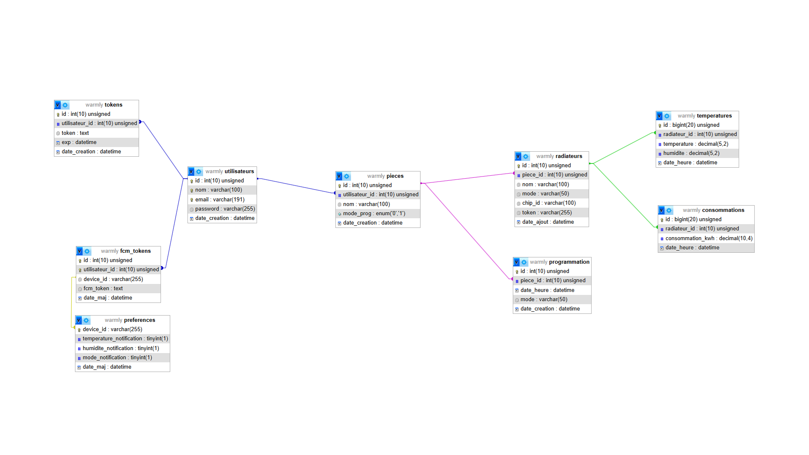
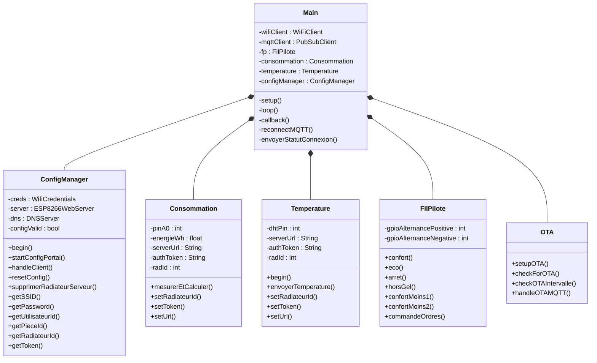
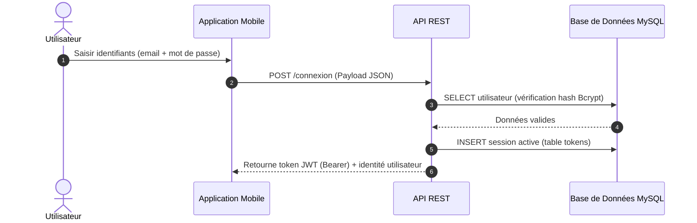
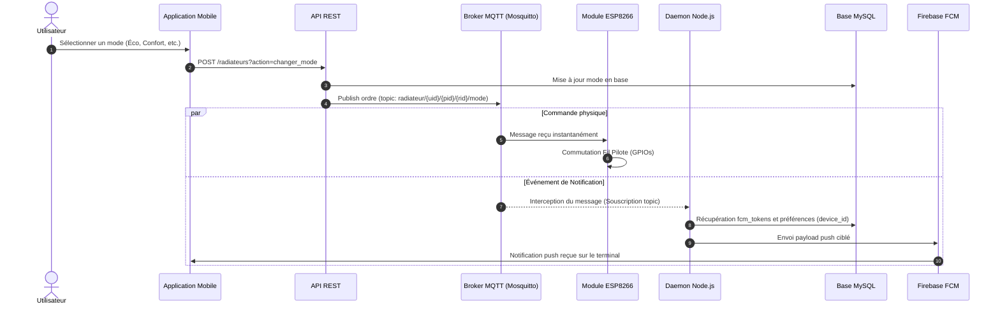
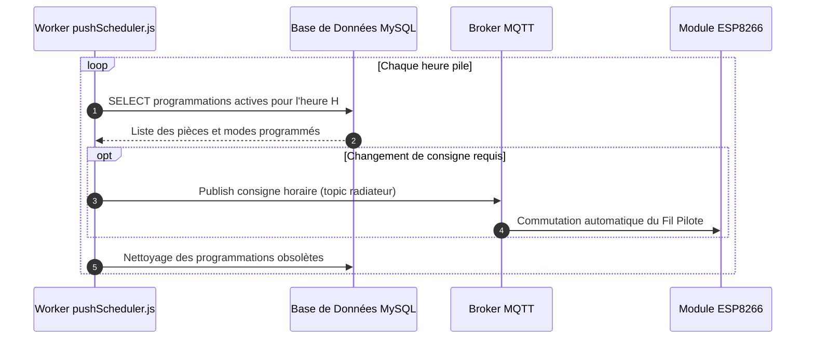
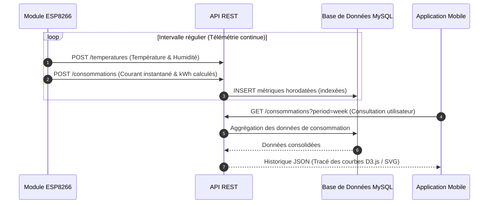

# 🌡️ Warmly – Écosystème IoT & Cloud pour Radiateurs Connectés

**Warmly** est une solution complète d'optimisation énergétique permettant de convertir des radiateurs électriques traditionnels (à Fil Pilote 4 et 6 ordres) en équipements connectés intelligents. Le projet permet de **réduire jusqu'à 15 % la facture de chauffage** grâce à des plannings automatisés, un suivi de télémétrie en temps réel (kWh, température, humidité) et un système d'alerting réactif.

---

## 📷 Démonstration Vidéo
👉 **[Regarder la vidéo de présentation et de démonstration (YouTube)](https://youtu.be/BLQS33lYxwc)**

---

## 🎯 Objectifs du projet
* **Pilotage intelligent à distance :** Contrôle des ordres Fil Pilote (*Confort, Éco, Hors-Gel, Arrêt, Confort -1, Confort -2*) via application mobile.
* **Sobriété énergétique & Automatisation :** Ordonnancement horaire hebdomadaire pour éliminer les gaspillages de chauffe.
* **Supervision & Observabilité (Télémétrie) :** Visualisation graphique en temps réel de la consommation électrique (kWh) et du climat ambiant (température/humidité).
* **Alerting temps réel :** Système de notifications push instantanées (Firebase Cloud Messaging) avec gestion fine des préférences par terminal physique (`device_id`).

---

## 🔧 Stack Technique & Architecture
* **IoT Embarqué :** Microcontrôleur **ESP8266** (C++ modulaire), capteur de courant (ACS712), sonde thermique (DHT), gestion Fil Pilote (optocoupleurs/diodes) et mise à jour OTA (Over-The-Air).
* **Flux Réseau & Protocoles :** **MQTT** (broker Mosquitto pour les flux temps réel asynchrones légers), HTTP/REST (télémétrie et provisioning), Wi-Fi captif.
* **Backend & Daemon :** API REST en PHP (PDO sécurisé), Workers et scripts d'ordonnancement en **Node.js** (CRON, écoute MQTT).
* **Base de Données :** **MySQL** (modélisation relationnelle complète, clés étrangères, index de performance).
* **Application Mobile :** **React Native / Expo** (TypeScript, D3.js pour les graphiques, architecture par composants).
* **Infrastructure & Sécurité :** Serveur Linux Debian, conteneurisation Docker, tokens JWT (`Bearer`), hachage Bcrypt des mots de passe.

---

## 📁 Structure du dépôt
- `Frontend/` : Code source de l'application mobile en React Native (TypeScript).
- `Backend/` : 
  - `warmly_api/` : API REST PHP pour la gestion de l'authentification, des équipements et des mesures.
  - `warmly_scripts/` : Daemons et workers Node.js (écoute MQTT, notifications push FCM, tâches CRON).
  - `database/` : 
    - `warmly_database.sql` : Script d'initialisation complet (9 tables, clés étrangères, index et seed data).
    - `warmly_database.png` : Schéma relationnel (ERD) de la base de données.
- `ESP8266/` : Code embarqué (C++ / Arduino) du microcontrôleur (Wi-Fi, Fil Pilote, Capteurs, OTA).
- `Docs/` : Diagrammes d'architecture, de classe et de séquence (PlantUML / Mermaid).

---

## 📊 Architecture, Flux Réseaux & Diagrammes

<b>👁️ Schéma Relationnel : Base de Données (MySQL)</b>

> Modèle conceptuel et structure relationnelle des 9 tables de l'écosystème Warmly (`warmly_database.png`).

  

<b>👁️ Diagramme de Classe : Code Embarqué ESP8266 (C++)</b>

> Architecture orientée objet du firmware assurant l'autonomie du module, la gestion du portail captif et la sécurité thermique.

<b>👁️ Diagramme de Séquence : Authentification Sécurisée (JWT)</b>

<b>👁️ Diagramme de Séquence : Commande Temps Réel & Notifications (Pub/Sub MQTT)</b>

> Architecture événementielle : l'ordre est routé via MQTT et le worker Node.js intercepte l'événement pour notifier les appareils mobiles selon leurs préférences (`device_id`).

<b>👁️ Diagramme de Séquence : Automatisation Horaire (CRON & Ordonnanceur)</b>

<b>👁️ Diagramme de Séquence : Télémétrie & Supervision Continue</b>

---

## 🛠️ Compétences Techniques & Méthodologie

* **DevOps & Administration Système :**
  * Déploiement et sécurisation d'environnements Linux (Debian).
  * Conteneurisation de microservices sous **Docker** et gestion des réseaux internes.
  * Tâches d'automatisation et de maintenance récurrente via scripts Node.js / Bash.
* **Architecture Réseau & Protocoles :**
  * Gestion des flux synchrones (**REST / HTTP**) et asynchrones temps réel (**MQTT**).
  * Séparation des contextes réseau (Wi-Fi local provisionné par portail captif vs communication Cloud).
* **Cybersécurité & Données :**
  * Sécurisation des flux : authentification par jetons **JWT**, hachage sécurisé des mots de passe.
  * Intégrité de la base de données : requêtes préparées (protection contre les injections SQL), intégrité référentielle (`ON DELETE CASCADE`).
  * Découplage de la gestion multi-appareils (`device_id`) pour un filtrage granulaire des notifications.
* **Supervision & Troubleshooting :**
  * Analyse de logs (serveur web, broker MQTT, moniteur série microcontrôleur).
  * Résolution des incidents de connectivité et fiabilisation des reconnexions automatiques (Watchdog).

---

## 🙋‍♂️ Auteur
* **Walid KABLI**
* *LinkedIn :* [linkedin.com/in/walid-kabli](https://linkedin.com/in/walid-kabli)
* *GitHub :* [github.com/wkabtech](https://github.com/wkabtech)
